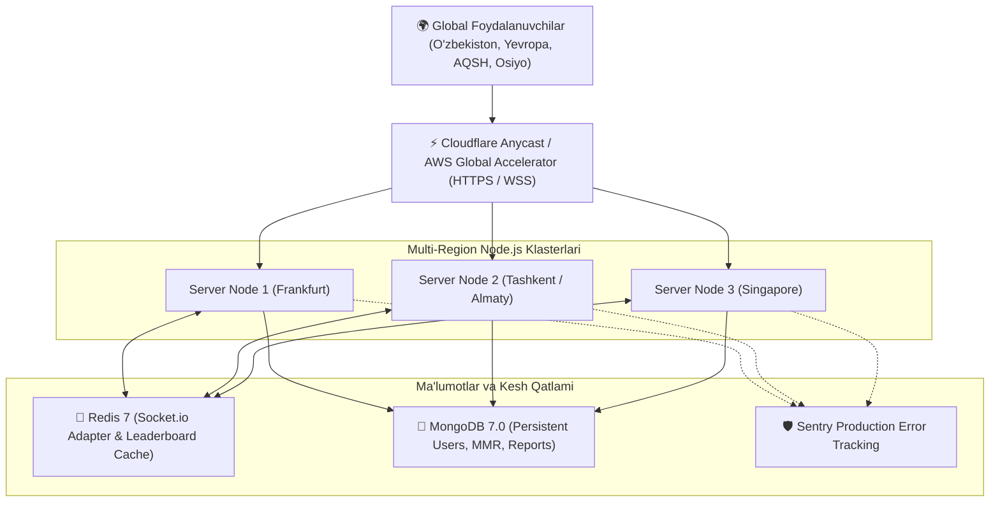

# MAFIYA Enterprise — Deployment, Security & Scalability Guide

Ushbu qo'llanmada **"Mafiya"** veb-ilovasining ishlab chiqarish (production) muhitiga joylash, gorizontal masshtablash, xavfsizlik va monitoring tizimlari batafsil bayon etilgan.

---

## 1. 🏗️ Arxitektura va Texnologiyalar To'plami (Tech Stack)

- **Backend:** Node.js (v20+ / v22 LTS), Express 5, Socket.io (v4.8+)
- **Gorizontal Masshtablash:** `@socket.io/redis-adapter` va Redis 7 (Alpine)
- **Ma'lumotlar Bazasi:** MongoDB / PostgreSQL (persistentsiya) + Redis (Mavsumiy Leaderboard keshi)
- **Konteynerizatsiya:** Docker & Docker Compose
- **Xavfsizlik:** Scrypt parol xeshlash, JWT tokenlar, HTTPS majburiy yo'naltirish, Zero Client Trust
- **Monitoring:** Sentry Error Tracking (`@sentry/node`), strukturaviy JSON loglar (`logs/app.log`, `logs/error.log`)



---

## 2. 🚀 Docker orqali Tezkor Ishga Tushirish

Barcha xizmatlarni (Node.js server, Redis kesh & adapter, MongoDB) bir buyruq bilan ishga tushirish:

```bash
# 1. Konfiguratsiyani sozlash (.env)
cp .env.example .env

# 2. Docker Compose konteynerlarini ishga tushirish
docker compose up -d --build

# 3. Konteynerlar holatini tekshirish
docker compose ps

# 4. Loglarni real vaqtda kuzatish
docker compose logs -f mafiya-server
```

---

## 3. 🌐 Multi-Region Deployment (Past Kechikish - Low Latency)

Dunyoning turli burchaklaridagi o'yinchilar past ping bilan real vaqtda o'ynashlari uchun quyidagi konfiguratsiya tavsiya etiladi:

1. **Anycast Routing (Cloudflare Enterprise yoki AWS Global Accelerator):**
   - O'yinchining so'rovi eng yaqin server tuguniga (Edge Location) yo'naltiriladi.
   - WSS (WebSocket Secure) ulanishlari SSL/TLS orqali himoyalanadi.
2. **Redis Adapter (`@socket.io/redis-adapter`):**
   - Istalgan hududdagi serverdagi o'yinchi boshqa hududdagi serverdagi xonadoshiga xabar yoki harakat yuborganida, Redis Pub/Sub hodisani <5ms ichida barcha instansiyalarga yetkazadi.
3. **Mavsumiy Leaderboard Kesh:**
   - Reytinglar Redisda `cache:leaderboard` kalitida 30 soniyalik TTL bilan keshlangan, bu millionlab so'rovlar oqimida bazaga ortiqcha yuk tushishini oldini oladi.

---

## 4. 🛡️ Server-Authoritative Xavfsizlik (Zero Client Trust)

1. **Maxfiy Rollar Himoyasi:**
   - Brauzer (klient) hech qachon o'yindagi boshqa o'yinchilarning rollarini vaqtidan oldin ololmaydi.
   - Har bir Socket.io hodisasi har bir o'yinchiga xususiy tarzda filtrlanib yuboriladi (`getClientStateFor(playerId)`).
   - O'yin tugamaguncha hatto tomoshabinlarga ham tiriklarning roli berilmaydi.
2. **Qat'iy Faza va Harakat Validatsiyasi:**
   - Tungi harakatlar faqat `night` fazasida, tirik va tegishli rol egasi tomonidan amalga oshiriladi.
   - Bir o'yinchi bir turda faqat 1 ta ovoz bera oladi.
   - Detektiv yoki Manyak o'zini o'zi nishonga ololmaydi.
   - O'yindan chiqqan o'yinchi ovoz bera olmaydi yoki tungi qotillik qila olmaydi.
3. **Chat Moderatsiyasi va Sukutga Olish (Auto-Mute):**
   - Har bir xabar `chatFilter.js` orqali tekshiriladi.
   - Nomaqbul yoki haqoratli so'zlar yulduzchalar (`***`) bilan tozalanadi.
   - Agar foydalanuvchi bir xonada 3 marta haqoratli so'z yuborsa, tizim uni avtomatik 1 daqiqaga ovozsiz holatga (mute) o'tkazadi va ma'lumotlar bazasida moderatorlar uchun shikoyat qayd etadi.
   - Flood/Spamdan himoya: 1 soniyada maksimal 4 ta xabar.
4. **HTTPS Majburiy Yo'naltirish & Xavfsiz Headerlar:**
   - `Strict-Transport-Security: max-age=31536000; includeSubDomains`
   - `X-Content-Type-Options: nosniff`
   - `X-Frame-Options: SAMEORIGIN`
   - `X-XSS-Protection: 1; mode=block`

---

## 5. 🔄 Aloqa Uzilishi va Qayta Ulanish (Reconnection & Grace Period)

- **Avtomatik Qayta Ulanish:** Agar o'yinchining interneti uzilsa va qayta tiklansa, brauzer avtomatik ravishda `reconnect_session` yuboradi va o'z o'rniga, chat tarixiga va o'yin holatiga qaytadi.
- **60 Soniyalik Grace Period:** Agar o'yinchi 60 soniya ichida qaytmasa:
  - Uning o'rnini aqlli **AI Bot (Bot Takeover)** egallaydi va o'yin to'xtab qolmasdan davom etadi.
  - Lobbi bosqichida bo'lsa, o'yinchi ro'yxatdan chiqariladi.

---

## 6. 👑 Administrator Paneli Imkoniyatlari

Admin panelga kirish: `http://localhost:7122#admin` *(Parol: `admin7122`)*

- **Faol Xonalar:** Hozirda o'ynalayotgan barcha xonalar, o'yinchilar soni, fazasi ko'rinadi va majburiy yopish mumkin.
- **Ovozsiz Qilish (Mute):** Qoidabuzar o'yinchilarni 15 daqiqadan 24 soatgacha chatdan mahrum qilish.
- **Bloklash (Ban):** Abusive yoki cheat qiluvchi akkauntlarni to'liq bloklash va jonli sessiyasini uzish.
- **Shikoyatlar (User Reports):** O'yinchilar tomonidan yuborilgan shikoyatlarni ko'rish, o'rganish va chora ko'rish.
- **Global E'lon (Broadcast):** Barcha ulangan foydalanuvchilar ekraniga bir vaqtda rasmiy e'lon yuborish.

---

## 7. 🧪 Avtomatlashtirilgan Testlar

Barcha testlarni ishga tushirish uchun:

```bash
npm test
```

Ushbu testlar quyidagilarni 100% qamrab oladi:
- `test/server_test.js` — Rol taqsimoti, Mafiya/Fuqaro g'alabasi, kunduzgi linch sudi.
- `test/manager_test.js` — Xonalar yaratish, sozlamalarni yangilash, botlar integratsiyasi.
- `test/advanced_test.js` — Mayor x2 ovozi, Masxaraboz (Jester) g'alabasi, Sevishganlar zanjirli o'limi, Manyak solo g'alabasi.
- `test/ai_bots_test.js` — Scrypt xeshlash, Email/Google auth, bot shaxsiyatlari, auto-fill, bot himoyalanish nutqi.
- `test/core_logic_test.js` — Server-authoritative Zero-Trust filtrlash, out-of-turn bloklash, chat senzurasi, mavsumiy reyting darajalari (Bronze, Silver, Gold, Diamond, Grandmaster).
